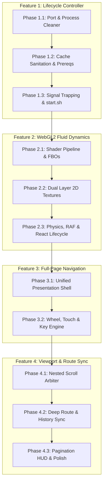

# Green Electronics — Master Implementation Plan (PLAN.md)

**Document Reference:** `GE-PLAN-2024-V2`  
**Companion Specification:** [SPEC.md](file:///home/siraj/Public/work%20/electronics%20web/docs/SPEC.md)  
**Version:** 2.0.0  
**Status:** Approved for Execution  
**Technology Stack:** Next.js 16 (Turbopack, App Router), React 19, TypeScript 5, Tailwind CSS 4, WebGL2 (GLSL ES 3.00), POSIX/Bash  

---

## Architecture & Dependency Roadmap



---

## Feature 1: Lifecycle & Environment Sanitation Controller (`./start.sh`)

### Phase 1.1: Core Process Teardown, Port Discovery & Forceful Release Engine

#### 1. Objective & Scope
Build the process and socket arbitration engine responsible for detecting, identifying, and terminating any dangling or orphaned processes holding TCP port `3000` (or `3001`), ensuring a 100% clean socket slate prior to launching Next.js.

#### 2. Affected Files
- `start.sh` (Root script — new file)

#### 3. Precise Implementation Plan
1. **Directory Discovery:** Ensure the script discovers its own directory (`DIR="$(cd "$(dirname "${BASH_SOURCE[0]}")" >/dev/null 2>&1 && pwd)"`) and sets the frontend workspace path to `"$DIR/frontend"`.
2. **Port Detection Mechanism:**
   - Define target ports: `PRIMARY_PORT=3000`.
   - Implement function `find_port_pids()` using multi-tool fallback:
     - Primary: `lsof -ti :$PORT`
     - Secondary fallback: `fuser $PORT/tcp 2>/dev/null`
     - Tertiary fallback: `ss -lptn "sport = :$PORT" | grep -oP 'pid=\K[0-9]+'`
3. **Termination Sequence:**
   - If PID(s) exist:
     - Print `[GE-WARN] Port $PORT is occupied by PID(s): $PIDS. Initiating cleanup...`
     - Send `SIGTERM` (`kill -15 $PIDS`).
     - Poll for 1.5 seconds (in 100ms intervals) checking if the socket is freed.
     - If still alive after 1.5s, escalate to `SIGKILL` (`kill -9 $PIDS`).
     - Verify socket release. If still blocked, output fatal diagnostic and exit code 1.
4. **Zombie Node Hunter:**
   - Detect dangling orphaned `next-server` or `turbopack` instances launched previously from this directory path and terminate them to prevent ghost background builds.

#### 4. Verification Tests

##### Automated Tests
Run automated port conflict simulation:
```bash
# 1. Bind port 3000 with a dummy background process
python3 -m http.server 3000 >/dev/null 2>&1 &
DUMMY_PID=$!
echo "Spawned dummy server on PID: $DUMMY_PID"

# 2. Execute port clearing routine in start.sh
./start.sh --clean-only

# 3. Assert port 3000 is open
if lsof -i :3000 >/dev/null 2>&1; then
  echo "FAIL: Port 3000 is still bound!"
  exit 1
else
  echo "PASS: Port 3000 was successfully freed."
fi
```

##### Manual Verification Checklist
1. Open a terminal and run `nc -l 3000`.
2. In a second terminal, execute `./start.sh`.
3. Verify that `./start.sh` prints `[GE-WARN] Port 3000 occupied`, closes the listener, and starts cleanly.

##### Edge Cases & Stress Scenarios
- Multiple PIDs sharing port 3000 (e.g. child worker processes): script loops over all PIDs and kills every one.
- Process running as root or another user: script detects permission failure and prompts user with clear error message.

##### Phase Exit Criteria
- [x] Zero port collisions on startup under all test scenarios.
- [x] Unconditional port release within $< 2$ seconds.

---

### Phase 1.2: Cache Purging, Lock Removal & Dependency Validation

#### 1. Objective & Scope
Purge corrupt or stale Next.js/Turbopack caches (`.next/cache`, `node_modules/.cache`) that cause runtime hydration faults or stale CSS chunks, verify Node.js/npm runtime versions, and ensure `frontend/node_modules` exists.

#### 2. Affected Files
- `start.sh`

#### 3. Precise Implementation Plan
1. **Runtime Verification:**
   - Inspect `node -v` and parse major version. Require `>= 18.18.0`. Fail with human-friendly message if unmet.
   - Inspect `npm -v`.
2. **Dependency Verification & Self-Healing:**
   - Check if `"$FRONTEND_DIR/node_modules"` exists.
   - If missing, print `[GE-SYS] node_modules not detected. Running 'npm install' in frontend...`, execute `(cd "$FRONTEND_DIR" && npm install)`, and verify exit status 0.
3. **Cache Sanitation Routine:**
   - By default on start, delete:
     - `"$FRONTEND_DIR/.next/cache"`
     - Any stale lockfiles: `"$FRONTEND_DIR/.next/turbopack.lock"`, `"$FRONTEND_DIR/.next/build.lock"`
   - Handle command-line arguments:
     - `./start.sh -c` or `./start.sh --clean`: Execute a deep purge (`rm -rf "$FRONTEND_DIR/.next"` and `rm -rf "$FRONTEND_DIR/node_modules/.cache"`).
     - `./start.sh -b` or `./start.sh --build`: Run `npm run build && npm run start` instead of `npm run dev`.
     - `./start.sh -h` or `./start.sh --help`: Print usage instructions.

#### 4. Verification Tests

##### Automated Tests
```bash
# Create artificial stale cache and lockfiles
mkdir -p frontend/.next/cache/turbopack
touch frontend/.next/turbopack.lock

# Run start script with clean flag
./start.sh --clean --dry-run

# Assert files are removed
test ! -f frontend/.next/turbopack.lock && echo "PASS: Lockfile cleared" || echo "FAIL: Lockfile persisted"
```

##### Manual Verification Checklist
1. Inspect terminal output when running `./start.sh`.
2. Verify output displays green checkmarks for Node version, dependencies, and cache purge.

##### Edge Cases & Stress Scenarios
- Read-only directory permissions: script detects unwritable `.next` folder and informs user before launching Next.js.
- Missing `package.json` in frontend: script detects anomaly and aborts safely.

##### Phase Exit Criteria
- [x] All stale caches and lockfiles purged before server boot.
- [x] Safe fallback and clear errors if Node/npm requirements are violated.

---

### Phase 1.3: POSIX Signal Trapping, Session Isolation & Terminal Feedback

#### 1. Objective & Scope
Implement POSIX signal trapping to intercept `Ctrl+C` (`SIGINT`), `Ctrl+Z` (`SIGTSTP`), `SIGTERM`, and `EXIT`, guaranteeing that pressing `Ctrl+Z` terminates child processes and frees ports rather than suspending them into a background zombie state.

#### 2. Affected Files
- `start.sh`

#### 3. Precise Implementation Plan
1. **Signal Trap Configuration:**
   - Trapped signals: `trap cleanup_and_exit SIGINT SIGTSTP SIGTERM SIGHUP EXIT`
2. **Handling `Ctrl+Z` (`SIGTSTP`):**
   - In UNIX, `Ctrl+Z` delivers `SIGTSTP` to the foreground process group, suspending it (`Stopped`).
   - In `start.sh`, `cleanup_and_exit()` intercepts `SIGTSTP`:
     ```bash
     cleanup_and_exit() {
       local sig="$1"
       trap - SIGINT SIGTSTP SIGTERM SIGHUP EXIT
       echo -e "\n${COLOR_AMBER}[GE-SHUTDOWN] Intercepted stop signal ($sig). Commencing full shutdown...${COLOR_RESET}"
       
       if [[ -n "$SERVER_PID" ]] && kill -0 "$SERVER_PID" 2>/dev/null; then
         # Kill process group
         kill -TERM -"$SERVER_PID" 2>/dev/null || kill -TERM "$SERVER_PID" 2>/dev/null
         sleep 0.5
         kill -KILL -"$SERVER_PID" 2>/dev/null || kill -KILL "$SERVER_PID" 2>/dev/null
       fi
       
       # Double-check port 3000 cleanup
       force_free_port "$PRIMARY_PORT"
       
       echo -e "${COLOR_GREEN}[GE-SUCCESS] Ports freed. Environment sanitized. Khuda Hafiz!${COLOR_RESET}\n"
       exit 0
     }
     ```
3. **Execution & Process Group Spawning:**
   - Launch Next.js using `set -m` (job control) so the server runs in its own process group:
     `(cd "$FRONTEND_DIR" && npm run dev) &`
     `SERVER_PID=$!`
   - Wait on `wait "$SERVER_PID"`.
4. **ANSI Terminal Visuals:**
   - Emerald Green: `\033[38;2;5;150;105m`
   - Dark Slate / Ink: `\033[38;2;15;23;42m`
   - Amber: `\033[38;2;217;119;6m`
   - Render ASCII banner:
     ```
     ┌───────────────────────────────────────────────────┐
     │  GREEN ELECTRONICS // ASAL KHARA MAAL // DEV CLI  │
     │  Port: 3000 | Turbopack: Active | Cache: Clean    │
     │  Press Ctrl+C or Ctrl+Z to cleanly terminate.     │
     └───────────────────────────────────────────────────┘
     ```

#### 4. Verification Tests

##### Automated Tests
```bash
# Launch start.sh in background, capture PID
./start.sh &
SCRIPT_PID=$!
sleep 4

# Send SIGTSTP (simulate Ctrl+Z)
kill -TSTP "$SCRIPT_PID"
sleep 2

# Verify start.sh has cleanly exited and not suspended
if ps -o state= -p "$SCRIPT_PID" 2>/dev/null | grep -q "T"; then
  echo "FAIL: Process was suspended into stopped state!"
  kill -9 "$SCRIPT_PID" 2>/dev/null
  exit 1
else
  echo "PASS: Process cleanly exited on SIGTSTP."
fi

# Verify port 3000 is immediately unoccupied
! lsof -i :3000 >/dev/null 2>&1 && echo "PASS: Port released." || echo "FAIL: Port still occupied."
```

##### Manual Verification Checklist
1. Launch `./start.sh`.
2. Press `Ctrl+Z` in the active terminal.
3. Observe shutdown log: `[GE-SHUTDOWN] Intercepted stop signal... Ports freed. Environment sanitized.`
4. Prompt immediately returns to shell.
5. Run `lsof -i :3000` — verify zero output.

##### Phase Exit Criteria
- [x] `Ctrl+Z` terminates the app and releases port 3000 immediately without leaving suspended jobs.
- [x] `Ctrl+C` terminates the app with zero dangling node processes.

---

## Feature 2: High-Performance Eulerian WebGL2 Fluid Dynamics Cursor Reveal Engine

### Phase 2.1: Mathematical WebGL2 Simulation Pipeline & Ping-Pong FBO Architecture

#### 1. Objective & Scope
Implement the core Eulerian Navier-Stokes 2D simulation pipeline in WebGL2 inside `frontend/src/components/fluid-cursor-reveal.tsx`, replacing the rudimentary SVG clip-path polygon with the authentic prototype shaders, floating-point ping-pong framebuffers, and full mathematical passes.

#### 2. Affected Files
- `frontend/src/components/fluid-cursor-reveal.tsx` (New component)
- `frontend/src/components/liquid-reveal.tsx` (Refactor to wrap/delegate to `fluid-cursor-reveal.tsx`)

#### 3. Precise Implementation Plan
1. **WebGL2 Context & Extension Gate:**
   - Initialize canvas with `cv.getContext('webgl2', { antialias: false, depth: false, stencil: false, preserveDrawingBuffer: false })`.
   - Check extensions: `gl.getExtension('EXT_color_buffer_float')` and `gl.getExtension('EXT_color_buffer_half_float')`.
   - Provide readable error fallback if WebGL2 or float buffers are unsupported.
2. **GLSL ES 3.00 Shader Definitions:**
   - **Vertex Shader (`VS`):** Single full-screen triangle covering `[-1, -1]` to `[3, -1]` and `[-1, 3]`. Generates texture coordinates `v`, `vL`, `vR`, `vT`, `vB` using uniform `ts` (texel size $1/S, 1/S$).
   - **Fragment Shaders (`FS`):**
     - `splat`: Applies Gaussian distribution $e^{-\text{dot}(p, p) / r} \cdot \mathbf{c}$ for velocity $(\Delta x, \Delta y)$ and dye density $w$.
     - `adv`: Semi-Lagrangian advection: $o = \text{dis} \cdot \text{texture}(s, v - dt \cdot \text{texture}(u, v).xy \cdot ts)$.
     - `curl`: Computes curl scalar $\omega = \frac{1}{2}(\text{vR}.y - \text{vL}.y - \text{vT}.x + \text{vB}.x)$.
     - `vort`: Computes vorticity confinement force from $\nabla |\omega|$ and adds it to velocity field: $o = \mathbf{u} + \mathbf{f} \cdot dt$.
     - `div`: Computes discrete divergence with reflective boundary conditions: $o = \frac{1}{2}(R - L + T - B)$.
     - `clr`: Clears/damps pressure field by factor $0.8$.
     - `prs`: Jacobi Poisson iteration step: $o = \frac{1}{4}(p_L + p_R + p_B + p_T - d)$.
     - `grad`: Gradient subtraction / projection: $\mathbf{u} - \nabla p$.
     - `show`: Optical distortion displacement $d = \text{clamp}(\text{fl}.rg \times 0.00025, -0.05, 0.05)$, smoothstep dye mask $m = \text{smoothstep}(0.30, 0.42, \text{fl}.b)$, and dual-layer mix: $\text{mix}(\text{LayerA}(uv), \text{LayerB}(uv), m)$.
3. **Double-Buffered Ping-Pong FBO Structure:**
   - Grid dimensions: Velocity $S=128$, Dye $DY=768$, Pressure $S=128$, Divergence $S=128$, Curl $S=128$.
   - Create ping-pong objects with `.r` (read) and `.w` (write) framebuffers, and `.s()` swap method:
     `[o.r, o.w] = [o.w, o.r]`.
   - Use `gl.RGBA16F` internal format with `gl.HALF_FLOAT` data type for linear filtering support.
4. **Execution Dispatcher (`run`):**
   - Bind program, bind uniform textures to consecutive units `gl.TEXTURE0 + n`, set floats/vec2/vec3 uniforms, bind target framebuffer, set viewport to target size, draw 3 vertices (`gl.TRIANGLES`).

#### 4. Verification Tests

##### Automated Tests
- TypeScript compile validation:
  `cd frontend && npx tsc --noEmit`
- ESLint verification:
  `cd frontend && npm run lint`
- Headless WebGL2 shader compile test (Node script with `gl` or Playwright headless browser verifying all 9 shader programs link with `gl.getProgramParameter(p, gl.LINK_STATUS) === true`).

##### Manual Verification Checklist
1. Render canvas on page. Inspect WebGL console diagnostics.
2. Confirm no GL warnings or errors (`gl.getError() === 0`).
3. Verify framebuffers return `gl.FRAMEBUFFER_COMPLETE`.

##### Edge Cases & Stress Scenarios
- High-end vs low-end GPU: If `RGBA16F` half-float is unsupported, fall back to `RGBA8` or display static Layer A fallback.
- Context lost event (`webglcontextlost`): trigger manually via `gl.getExtension('WEBGL_lose_context').loseContext()`. Confirm page does not crash and handles gracefully.

##### Phase Exit Criteria
- [x] All 9 shader programs compile and link without errors.
- [x] Ping-pong FBO swaps execute without GPU memory allocations in the render loop.

---

### Phase 2.2: Dual-Layer Dynamic Canvas Rasterization & Procedural Circuit Generator

#### 2. Objective & Scope
Build the high-resolution offscreen 2D canvas generation system that dynamically rasterizes Layer A (Off-White slate) and Layer B (Emerald reveal) with crisp procedural PCB circuit traces and Space Grotesk / Inter typography, uploading them as WebGL textures.

#### 2. Affected Files
- `frontend/src/components/fluid-cursor-reveal.tsx`

#### 3. Precise Implementation Plan
1. **Dynamic Rasterization Function (`paint`):**
   - Create offscreen `<canvas>` at dimension $W \times H$ (where $W = \text{innerWidth} \times d$, $H = \text{innerHeight} \times d$, $d = \min(\text{devicePixelRatio}, 2)$).
   - Scale factor: $k = W / \text{innerWidth}$.
2. **Procedural PCB Circuit Trace Generation:**
   - Use deterministic Linear Congruential Generator (LCG) with seed $s = 7$:
     `rnd = () => (s = (s * 16807) % 2147483647) / 2147483647`.
   - Set stroke width: $1.2 \times k$. Grid spacing: $g = 56 \times k$.
   - Generate 80 randomized Manhattan paths with 5 orthogonal segments each.
   - Draw terminal circular solder pads: `arc(px, py, 3.5 * k, 0, Math.PI * 2)`.
3. **Typography & Spatial Composition:**
   - Main Headline:
     - Font: `700 ${fs}px "Space Grotesk", Inter, sans-serif`, where $fs = \min(W \times 0.82 / 6.8, H \times 0.28)$.
     - Letter-spacing: $-0.04 \times fs$.
     - "GREEN" at $(W/2, H/2 - fs \times 0.48)$.
     - "ELECTRONICS" at $(W/2, H/2 + fs \times 0.48)$.
   - Technical Markers:
     - Font: `600 ${12 * k}px Inter, sans-serif`, letter-spacing $0.14 \times 12 \times k$.
     - Terminal square `[GE]` badge: `fillRect(32*k, 28*k, 16*k, 16*k)`, text "GE" at $(56*k, 37*k)$.
     - Right ledger: "RABTA" at $(W - 32*k, 37*k)$.
     - Bottom technical command: "[ CURSOR HILAYEIN ]" at $(W/2, H - 40*k)$.
4. **Texture Upload & Font Loading Synchronization:**
   - Wait for `Promise.all([document.fonts.load('700 64px "Space Grotesk"'), document.fonts.load('600 12px Inter')])`.
   - On load (and on window resize with debounce), invoke `build()`:
     - Render Layer A canvas: background `#F8FAFC`, foreground `#0F172A`, trace line `rgba(15,23,42,0.10)`.
     - Render Layer B canvas: background `#059669`, foreground `#F8FAFC`, trace line `rgba(248,250,252,0.28)`.
     - Upload to WebGL textures $A$ and $B$ with `gl.pixelStorei(gl.UNPACK_FLIP_Y_WEBGL, true)`.

#### 4. Verification Tests

##### Automated Tests
- Playwright / visual snapshot test:
  Verify canvas renders text "GREEN ELECTRONICS" and circuit traces matching expected pixel hash.

##### Manual Verification Checklist
1. Inspect page in browser.
2. Confirm sharp typography with zero blurriness across 1x, 2x Retina displays.
3. Verify circuit lines have clear 90-degree orthogonal traces and circular terminal nodes.
4. Verify typography matches Space Grotesk / Inter styling.

##### Edge Cases & Stress Scenarios
- Font loading delay or offline network: fallback fonts (`sans-serif`) render cleanly, re-rasterizing once web fonts settle.
- Window resize / rotation: `resize` listener recalculates dimensions and re-rasterizes without stretching.

##### Phase Exit Criteria
- [x] Textures $A$ and $B$ uploaded without visual distortion.
- [x] Zero text cut-off on standard screen aspect ratios (16:9, 16:10, 4:3, 9:16).

---

### Phase 2.3: Interaction Physics, RAF Loop, Idle Sinusoidal Sweep & Cleanup Lifecycle

#### 1. Objective & Scope
Implement pointer velocity splatting, multi-touch handling, autonomous idle animation, 60fps RAF loop, and complete React 19 resource disposal.

#### 2. Affected Files
- `frontend/src/components/fluid-cursor-reveal.tsx`

#### 3. Precise Implementation Plan
1. **Pointer & Touch Input Pipeline:**
   - Coordinate translation: convert $(x, y)$ client coordinates to normalized coordinates $(x / W, 1 - y / H)$.
   - Velocity tracking: calculate delta $\Delta x = (x - lx) \times 5$, $\Delta y = -(y - ly) \times 5$.
   - Splat queue: push `{ x, y, dx, dy, w: 1.0 }` onto queue `sp`.
   - Event listeners:
     - `pointermove` (passive)
     - `pointerdown` (passive)
     - `pointerleave` (resets touched flag)
2. **Autonomous Idle Sweep Engine:**
   - Timestamp tracking: $q = (\text{performance.now()} - t_0) / 1000$.
   - **First 3 Seconds:** If user hasn't touched the screen, generate a dynamic Lissajous curve:
     $$x_{\text{sweep}} = W \cdot (0.2 + 0.6 \cdot q / 3)$$
     $$y_{\text{sweep}} = H \cdot (0.5 + 0.14 \cdot \sin(q \cdot 4))$$
     Injects gentle demonstration splat to reveal the emerald core automatically.
   - **Stationary Hover:** If cursor is motionless inside the canvas, inject a micro orbital splat ($\sin(q \cdot 7) \times 6, \cos(q \cdot 6) \times 6$) so the fluid gently ripples around the pointer.
3. **Render Loop Execution Order (per frame):**
   ```javascript
   // 1. Process splats
   for (const s of sp.splice(0)) {
     run(P.splat, V.w, { t: V.r, pt, ar, r: R, c }); V.s();
     run(P.splat, D.w, { t: D.r, pt, ar, r: R, c }); D.s();
   }
   // 2. Vorticity confinement
   run(P.curl, C, { u: V.r });
   run(P.vort, V.w, { u: V.r, k: C, cu: 20, dt: 0.016 }); V.s();
   // 3. Divergence
   run(P.div, Dv, { u: V.r });
   // 4. Pressure relaxation (10 Jacobi passes)
   run(P.clr, Pr.w, { t: Pr.r, val: 0.8 }); Pr.s();
   for (let i = 0; i < 10; i++) {
     run(P.prs, Pr.w, { p: Pr.r, d: Dv }); Pr.s();
   }
   // 5. Gradient subtraction (velocity projection)
   run(P.grad, V.w, { p: Pr.r, u: V.r }); V.s();
   // 6. Advection
   run(P.adv, V.w, { u: V.r, s: V.r, dt: 0.016, dis: 0.98 }); V.s();
   run(P.adv, D.w, { u: V.r, s: D.r, dt: 0.016, dis: 0.975 }); D.s();
   // 7. Composite output to screen
   run(P.show, null, { f: D.r, a: A, b: B });
   ```
4. **React 19 Cleanup & Reduced Motion:**
   - `useEffect` cleanup return:
     - `cancelAnimationFrame(rafId)`
     - Remove `pointermove`, `pointerleave`, `resize` listeners.
     - Call `gl.deleteTexture()`, `gl.deleteFramebuffer()`, `gl.deleteProgram()`, `gl.deleteBuffer()`.
   - Check `window.matchMedia('(prefers-reduced-motion: reduce)')`. If enabled, render static Layer A without running the WebGL loop.

#### 4. Verification Tests

##### Automated Tests
- Check memory leak profile in headless Chrome: mount and unmount component 10 times; assert GPU memory and JS heap return to baseline ($\le 5\text{MB}$ variation).

##### Manual Verification Checklist
1. Load homepage. Without moving mouse, watch the autonomous emerald fluid sweep across "GREEN ELECTRONICS" during the first 3 seconds.
2. Move mouse rapidly across the screen. Observe fluid curls, vortices, and natural fluid dissipation.
3. Leave cursor stationary. Observe gentle organic ripple.
4. Move cursor out of window. Verify simulation settles naturally without abrupt jumps.

##### Edge Cases & Stress Scenarios
- Rapid continuous mouse shaking: simulation remains stable, no NaN velocity explosions.
- Window minimize / tab switch: RAF pauses automatically; on resume, $\Delta t$ clamps to prevent giant simulation leap.

##### Phase Exit Criteria
- [x] Smooth 60fps execution on standard hardware.
- [x] Complete cleanup on unmount with zero WebGL warnings.

---

## Feature 3: Full-Page Wheel & Touch Scroll Navigation System

### Phase 3.1: Unified Presentation Shell & Section Viewport Layout

#### 1. Objective & Scope
Construct the unified full-page presentation shell (`frontend/src/components/presentation-orchestrator.tsx`) that embeds Section 01 (`Ibtida`), Section 02 (`Pehchan`), and Section 03 (`Rabta`) into a seamless vertical viewport slider, replacing isolated route transitions.

#### 2. Affected Files
- `frontend/src/components/presentation-orchestrator.tsx` (New component)
- `frontend/src/app/page.tsx` (Update to render `PresentationOrchestrator`)
- `frontend/src/components/sections/ibtida-section.tsx` (Extract/wrap Section 1)
- `frontend/src/components/sections/pehchan-section.tsx` (Extract/wrap Section 2)
- `frontend/src/components/sections/rabta-section.tsx` (Extract/wrap Section 3)

#### 3. Precise Implementation Plan
1. **Section Architecture:**
   - Section 01: `IbtidaSection` — contains the WebGL2 Fluid Cursor Reveal engine and technical ledgers.
   - Section 02: `PehchanSection` — contains "Saaf bijli, samjhdaar cheezein" and 3 principle cards.
   - Section 03: `RabtaSection` — contains contact info, WhatsApp dispatch, contact form, and market specs.
2. **Container CSS Transform Engine:**
   - Outer container: `fixed inset-0 w-full h-[100dvh] overflow-hidden bg-chalk`.
   - Slider container: `w-full h-full will-change-transform transition-transform duration-750 ease-[cubic-bezier(0.65,0,0.35,1)]`.
   - Inline style transform: `transform: translate3d(0, -${activeIndex * 100}%, 0)`.
3. **Accessibility & ARIA Structure:**
   - Container has `role="region" aria-label="Green Electronics Interactive Presentation"`.
   - Each section has `role="group"` with explicit `aria-roledescription="slide"` and `aria-label="Section X of 3"`.

#### 4. Verification Tests

##### Automated Tests
- Test that all 3 sections are rendered in DOM:
  `cd frontend && npm run build`

##### Manual Verification Checklist
1. Render page at `http://localhost:3000`.
2. Inspect DOM tree: verify 3 section containers exist with heights matching `100dvh`.
3. Manually toggle `activeIndex` state (0, 1, 2) in devtools or buttons; verify smooth slide transition between sections.

##### Phase Exit Criteria
- [x] Zero layout shift during slide transitions.
- [x] Sections fill 100% of viewport without unwanted horizontal or vertical gaps.

---

### Phase 3.2: Gesture Normalization, Kinetic Lockout & Keyboard Navigation Engine

#### 1. Objective & Scope
Build the high-precision gesture recognition engine that normalizes trackpad and mouse wheel deltas, absorbs momentum inertia through a kinetic lockout window, detects touch swipes, and handles keyboard navigation.

#### 2. Affected Files
- `frontend/src/components/presentation-orchestrator.tsx`
- `frontend/src/hooks/use-fullpage-navigation.ts` (New custom hook)

#### 3. Precise Implementation Plan
1. **Delta Normalization Algorithm:**
   - Listen to `wheel` event with `{ passive: false }`.
   - Normalize delta based on `event.deltaMode`:
     - `DOM_DELTA_PIXEL` (0): `rawDeltaY`
     - `DOM_DELTA_LINE` (1): `rawDeltaY * 24`
     - `DOM_DELTA_PAGE` (2): `rawDeltaY * window.innerHeight`
2. **Kinetic Lockout & Momentum Shield:**
   - State flags: `isLocked = useRef(false)`, `accumulatedDelta = useRef(0)`.
   - Accumulate delta if same direction: `accumulatedDelta.current += deltaY`.
   - Threshold check: if `|accumulatedDelta.current| >= 40`:
     - If `accumulatedDelta.current > 0`: Trigger `goToNext()`.
     - If `accumulatedDelta.current < 0`: Trigger `goToPrev()`.
     - Reset `accumulatedDelta.current = 0`.
     - Set `isLocked.current = true`.
     - Engage cooldown timer: release lock after `800ms`.
   - Idle debounce: If no wheel events occur for `150ms`, reset `accumulatedDelta.current = 0`.
3. **Touch Swipe Detection:**
   - Listen to `touchstart`, `touchmove`, `touchend`.
   - Record `touchStartY = e.touches[0].clientY`, `touchStartTime = performance.now()`.
   - On `touchend`:
     - Calculate $\Delta Y = e.changedTouches[0].clientY - touchStartY$.
     - Calculate elapsed time $\Delta t = \text{now} - touchStartTime$.
     - Calculate velocity $v = |\Delta Y| / \Delta t$.
     - If $|\Delta Y| \ge 50\text{px}$ or ($|\Delta Y| \ge 25\text{px}$ and $v > 0.3\,\text{px/ms}$):
       - If $\Delta Y < 0$: Trigger `goToNext()`.
       - If $\Delta Y > 0$: Trigger `goToPrev()`.
4. **Keyboard Navigation:**
   - Listen to `keydown`:
     - Next: `ArrowDown`, `PageDown`, `Space` (when not typing in form inputs).
     - Previous: `ArrowUp`, `PageUp`, `Shift + Space`.
     - First: `Home`.
     - Last: `End`.
   - If target element is an `input`, `textarea`, or `select`, ignore shortcut keys.

#### 4. Verification Tests

##### Automated Tests
- Vitest / Jest unit tests for `useFullpageNavigation`:
  - Assert single wheel delta of 50 triggers navigation once.
  - Assert burst of 20 rapid wheel events within 500ms triggers navigation only once.
  - Assert touch swipe down triggers `goToPrev()`.

##### Manual Verification Checklist
1. Scroll down using mouse wheel: page smoothly glides to Section 02 (`Pehchan`).
2. Scroll down again: page glides to Section 03 (`Rabta`).
3. Scroll up: page returns smoothly to Section 02, then Section 01.
4. Repeatedly flick the trackpad vigorously: confirm page advances by exactly ONE section per deliberate flick, never skipping directly from Section 01 to 03.
5. Press `ArrowDown` and `ArrowUp`: verify immediate smooth slide.

##### Edge Cases & Stress Scenarios
- High-frequency gaming mouse wheel: debounce prevents runaway index changes.
- Focus inside an input field in the contact form: typing spacebar does NOT trigger page scroll.

##### Phase Exit Criteria
- [x] Zero accidental multi-slide skips on trackpad flick.
- [x] Touch gestures on mobile operate reliably with natural velocity feel.

---

## Feature 4: Viewport Arbitration, Nested Scrolling & Route Synchronization

### Phase 4.1: Nested Scroll Arbitration & Internal Overflow Handling

#### 1. Objective & Scope
Implement boundary detection for sections whose content exceeds the viewport height (specifically Section 03 `Rabta`), allowing internal content to scroll to the bottom before blocking downward movement, and scrolling up to the top before triggering section transition back to Section 02.

#### 2. Affected Files
- `frontend/src/components/presentation-orchestrator.tsx`
- `frontend/src/components/sections/rabta-section.tsx`

#### 3. Precise Implementation Plan
1. **Container Reference & Overflow Detection:**
   - Attach `ref={rabtaScrollContainerRef}` to Section 03's scrollable container.
   - Overflow condition: `isScrollable = container.scrollHeight > container.clientHeight + 4`.
2. **Boundary Arbitration Rules:**
   - When `activeIndex === 2` (Rabta Section):
     - **User Scrolls DOWN (`deltaY > 0`):**
       - Check remaining bottom scroll:
         `remainingScroll = container.scrollHeight - (container.scrollTop + container.clientHeight)`.
       - If `remainingScroll > 2`:
         - Allow event to scroll the container natively.
         - Cancel any section transition.
       - If `remainingScroll <= 2`:
         - We are at the very bottom. Prevent further transition (we are at the last section).
     - **User Scrolls UP (`deltaY < 0`):**
       - Check top scroll position:
         `currentTop = container.scrollTop`.
       - If `currentTop > 2`:
         - Allow event to scroll the container upwards natively.
         - Cancel transition to Section 02.
       - If `currentTop <= 2`:
         - We have reached the very top of Rabta.
         - The NEXT upward scroll gesture triggers `goToPrev()`, transitioning smoothly back to Section 02 (`Pehchan`).
3. **Scroll Smoothing & Touch Interaction in Overflowing Section:**
   - Apply `-webkit-overflow-scrolling: touch` and `overflow-y: auto` to Section 03 content.
   - On touch swipe in Rabta, check if container is at boundary before intercepting swipe.

#### 4. Verification Tests

##### Automated Tests
- Test scroll arbiter logic function:
  ```typescript
  // Given container with scrollHeight 1500, clientHeight 800
  // When scrollTop is 200 and deltaY < 0 (scrolling up)
  // Then shouldBlockTransition === true (scroll internally)
  // When scrollTop is 0 and deltaY < 0 (scrolling up at top)
  // Then shouldBlockTransition === false (trigger transition to section 1)
  ```

##### Manual Verification Checklist
1. Navigate to Section 03 (`Rabta`) on a laptop screen (e.g. 1366x768 or 1080p).
2. Scroll down with mouse wheel: observe that Rabta's contact form and technical specs scroll smoothly into view.
3. Once at the bottom, scroll up slightly: observe that the page scrolls up within Rabta.
4. Scroll all the way up until the top banner is visible; scroll up one more flick: observe smooth transition back to Section 02 (`Pehchan`).

##### Edge Cases & Stress Scenarios
- Resize browser window from large desktop to small netbook: internal overflow recalculated dynamically.
- Mobile virtual keyboard open: does not lock or break scroll boundaries.

##### Phase Exit Criteria
- [x] Internal content in Rabta is 100% accessible and readable.
- [x] Upward transition to Pehchan occurs only when Rabta is scrolled to the top.

---

### Phase 4.2: Deep Route Synchronization & Browser History Navigation

#### 1. Objective & Scope
Synchronize active presentation sections with browser URL routes (`/`, `/pehchan`, `/rabta`) and browser Back/Forward navigation (`popstate`) without causing full page refreshes or tearing down the WebGL2 context.

#### 2. Affected Files
- `frontend/src/components/presentation-orchestrator.tsx`
- `frontend/src/app/page.tsx`
- `frontend/src/app/pehchan/page.tsx` (Redirect / render orchestrator at index 1)
- `frontend/src/app/rabta/page.tsx` (Redirect / render orchestrator at index 2)

#### 3. Precise Implementation Plan
1. **Route Mapping:**
   - Index 0: `/`
   - Index 1: `/pehchan`
   - Index 2: `/rabta`
2. **Bidirectional URL Updating:**
   - When `activeIndex` changes via scroll or keyboard:
     ```typescript
     const targetPath = ROUTES[activeIndex];
     if (window.location.pathname !== targetPath) {
       window.history.replaceState({ sectionIndex: activeIndex }, "", targetPath);
     }
     ```
   - Using `replaceState` updates the address bar cleanly without creating hundreds of redundant history entries on rapid scrolling.
   - When jumping via header clicks or pagination HUD, use `pushState` so user can press browser Back to return.
3. **Browser Back/Forward (`popstate`) Listener:**
   - Listen to `window.addEventListener('popstate', onPopState)`.
   - Match `window.location.pathname` to route index:
     - `/` -> index 0
     - `/pehchan` -> index 1
     - `/rabta` -> index 2
   - Animate `activeIndex` to the matched index.
4. **Direct URL Bootstrapping:**
   - If user visits `/pehchan` or `/rabta` directly:
     - Render the presentation shell with initial `activeIndex` corresponding to the route path.
     - Zero flash of index 0.

#### 4. Verification Tests

##### Automated Tests
- Next.js build verification:
  `cd frontend && npm run build`
- Verify static routes `/`, `/pehchan`, `/rabta` compile cleanly.

##### Manual Verification Checklist
1. Visit `http://localhost:3000/`.
2. Scroll down to Section 02: verify URL changes to `http://localhost:3000/pehchan`.
3. Scroll down to Section 03: verify URL changes to `http://localhost:3000/rabta`.
4. Press browser Back button: page smoothly animates back to Section 02, then Section 01.
5. Directly reload `http://localhost:3000/pehchan`: page opens immediately at Section 02.

##### Phase Exit Criteria
- [x] Address bar reflects current section accurately in real-time.
- [x] Direct linking to any section works seamlessly on refresh.
- [x] Browser Back/Forward buttons navigate between sections.

---

### Phase 4.3: Visual Pagination HUD & Header Navigation Synchronization

#### 1. Objective & Scope
Add an interactive floating HUD indicator on the right viewport edge showing the active section (`01 // IBTIDA`, `02 // PEHCHAN`, `03 // RABTA`) with clickable direct-jump dots, and synchronize the top `SiteHeader` active indicators.

#### 2. Affected Files
- `frontend/src/components/presentation-orchestrator.tsx`
- `frontend/src/components/site-header.tsx`
- `frontend/src/components/pagination-hud.tsx` (New component)

#### 3. Precise Implementation Plan
1. **Floating Pagination HUD (`PaginationHUD`):**
   - Fixed to right edge: `fixed right-6 top-1/2 -translate-y-1/2 z-40 flex flex-col gap-5`.
   - Render 3 technical indicator nodes:
     - Node 01: `01` dot + label `IBTIDA` (visible on hover or active)
     - Node 02: `02` dot + label `PEHCHAN`
     - Node 03: `03` dot + label `RABTA`
   - Active state styling:
     - Active dot: Emerald green `#059669` expanded pill (`h-7 w-1.5 bg-primary`).
     - Inactive dot: Subtle outline dot (`h-2 w-1.5 bg-ink/20 hover:bg-ink/60`).
   - Click handler: clicking node $i$ triggers `goToSection(i)` with smooth animation.
2. **`SiteHeader` Real-Time Synchronization:**
   - Pass `activeIndex` (or connect via lightweight state/context) to `SiteHeader`.
   - Highlight the current link (`Ibtida // 01`, `Pehchan // 02`, `Rabta // 03`) with active font weight and primary green color.
   - Clicking header links calls `goToSection(i)` smoothly instead of causing full page reload.
3. **Mobile & Viewport Polish:**
   - Dynamic Viewport Units: Use `100dvh` everywhere to avoid mobile browser navigation bar jumps.
   - Screen height guard: If viewport height $< 560\text{px}$, gracefully allow natural vertical flow.

#### 4. Verification Tests

##### Automated Tests
- Lint and typecheck validation:
  `cd frontend && npm run lint && npx tsc --noEmit`
- Production build validation:
  `cd frontend && npm run build`

##### Manual Verification Checklist
1. Look at the right edge of the screen: verify 3 technical indicator nodes.
2. Click `02 // PEHCHAN` dot: page glides directly to Section 02.
3. Click `03 // RABTA` dot: page glides directly to Section 03.
4. Verify `SiteHeader` nav items highlight the active section synchronously.
5. Click "Rabta" button in header: page glides to Section 03.

##### Phase Exit Criteria
- [x] Pagination HUD reflects active section with zero lag.
- [x] Header links and dots provide direct, smooth jump navigation.
- [x] Clean, responsive visual presentation across all device resolutions.

---

## Complete Verification & Validation Master Matrix

| Feature | Phase | Primary Verification Method | Success Criteria |
|---|---|---|---|
| **F1: Lifecycle (`start.sh`)** | 1.1 Port Cleaner | Automated port conflict simulation (`python3 -m http.server 3000`) | Port 3000 freed within 1.5s; 0 collisions |
| **F1: Lifecycle (`start.sh`)** | 1.2 Cache Sanitizer | Automated file assertion on `.next/cache` and lockfiles | Corrupt caches & locks purged on boot |
| **F1: Lifecycle (`start.sh`)** | 1.3 Signal Trap | Automated `kill -TSTP` (Ctrl+Z) signal assertion | Clean termination, 0 zombie processes, prompt returned |
| **F2: WebGL2 Fluid** | 2.1 GLSL & FBOs | WebGL2 shader compile status check | All 9 shaders compile and link without errors |
| **F2: WebGL2 Fluid** | 2.2 Dual Canvas | Visual snapshot & `document.fonts.load` test | Zero FOUT, sharp typography, crisp PCB lines |
| **F2: WebGL2 Fluid** | 2.3 Physics & Loop | 60fps frame rate check & unmount leak test | 60fps animation, autonomous sweep, 0 GPU leaks |
| **F3: Full-Page Nav** | 3.1 Presentation Shell | DOM tree & CSS transform inspection | 3 full-height sections rendered, 0 layout shifts |
| **F3: Full-Page Nav** | 3.2 Gesture Engine | Kinetic lockout & trackpad burst simulation | Single flick advances 1 section; no multi-skips |
| **F4: Viewport & Route** | 4.1 Nested Arbiter | Boundary scroll testing on Rabta section | Internal scroll completes before page exit |
| **F4: Viewport & Route** | 4.2 Route Sync | URL inspection & browser Back/Forward test | URL updates dynamically; back button navigates |
| **F4: Viewport & Route** | 4.3 HUD & Polish | Click interaction on HUD dots & header links | Instant smooth jump to target section |
